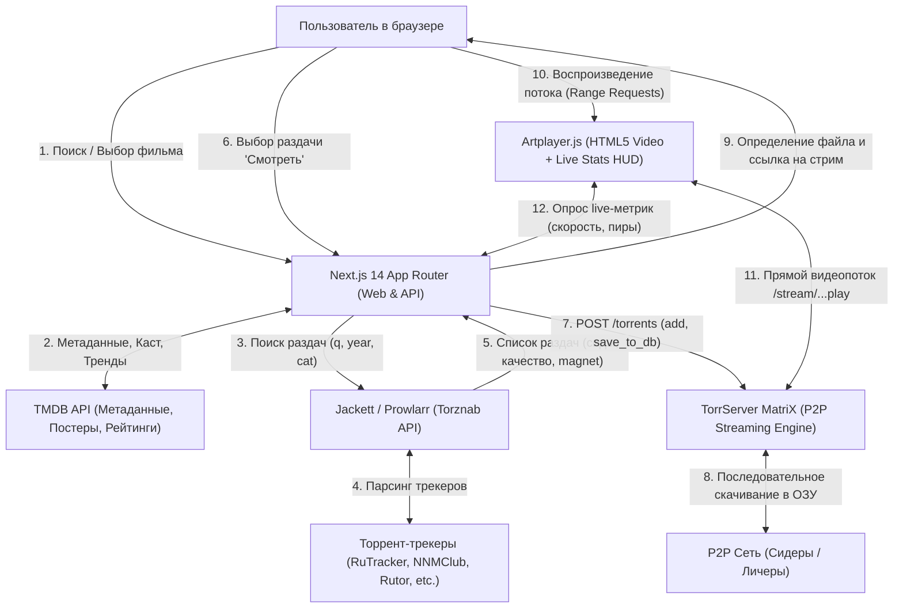

# 🎬 KinoStream — P2P Онлайн-кинотеатр (Next.js + TorrServer + Jackett)

Полнофункциональный современный веб-кинотеатр, который находит фильмы и сериалы через TMDB, ищет лучшие торрент-раздачи через Jackett / Prowlarr и транслирует видео **напрямую в браузере в реальном времени** с помощью TorrServer без предварительного скачивания на локальный диск.

---

## 🏛 Архитектура и поток данных



---

## 🚀 Быстрый запуск

### Вариант 1: Запуск через Docker Compose (Рекомендуемый)

Docker Compose поднимает в единой изолированной сети:
1. **Next.js Web-приложение** (`:3000`)
2. **TorrServer MatriX** (`:8090`)
3. **Jackett** (`:9117`)

1. Склонируйте репозиторий и перейдите в папку проекта:
   ```bash
   cd kino2
   ```

2. Создайте файл `.env.local` (или заполните `.env`):
   ```bash
   cp .env.example .env.local
   ```
   Укажите ваш ключ TMDB:
   ```env
   TMDB_API_KEY=ваш_tmdb_api_key
   ```

3. Запустите стек:
   ```bash
   docker-compose up -d --build
   ```

4. Откройте в браузере:
   - **Кинотеатр:** [http://localhost:3000](http://localhost:3000)
   - **TorrServer:** [http://localhost:8090](http://localhost:8090)
   - **Jackett:** [http://localhost:9117](http://localhost:9117)

5. В веб-интерфейсе Jackett (`http://localhost:9117`):
   - Скопируйте `API Key` (в правом верхнем углу интерфейса Jackett).
   - Добавьте ваши любимые трекеры (например: Rutracker, Rutor, NNM-Club, NoName Club, TorrentGalaxy).
   - Вставьте ключ в `.env.local` в поле `JACKETT_API_KEY` и перезапустите `docker-compose up -d web`.

---

### Вариант 2: Локальная разработка (Node.js)

1. Установите зависимости:
   ```bash
   npm install
   ```

2. Запустите TorrServer и Jackett (локально или в фоновых Docker-контейнерах):
   ```bash
   docker run -d --name torrserver -p 8090:8090 -v torrserver_data:/opt/ts/torrents ghcr.io/yourok/torrserver:latest
   docker run -d --name jackett -p 9117:9117 -v jackett_config:/config lscr.io/linuxserver/jackett:latest
   ```

3. Настройте файл `.env.local`:
   ```env
   TMDB_API_KEY=ваш_tmdb_ключ
   JACKETT_URL=http://localhost:9117
   JACKETT_API_KEY=ваш_jackett_api_ключ
   TORRSERVER_URL=http://localhost:8090
   NEXT_PUBLIC_TORRSERVER_URL=http://localhost:8090
   ```

4. Запустите dev-сервер:
   ```bash
   npm run dev
   ```
   Откройте [http://localhost:3000](http://localhost:3000).

---

## 🛠 Особенности реализации

### 1. Умный выбор видеофайла в торрентах (`torrserver.selectBestVideoFile`)
- Если раздача является фильмом с дополнительными материалами, семплами и трейлерами, алгоритм автоматически отфильтровывает файлы с ключевыми словами `sample`, `trailer`, `promo` и выбирает основной файл наибольшего размера с расширением `.mkv`, `.mp4`, `.avi`, `.webm`.
- Для сериалов поддерживается автоопределение нужного эпизода по маскам `S01E03`, `1x03`, `ep03` или «серия 3».
- В плеере доступен переключатель файлов, позволяющий на лету переключить серию или файл внутри раздачи.

### 2. Плеер Artplayer.js с живой телеметрией
- Прямая поддержка HTTP `206 Partial Content` (Range headers) для быстрой перемотки.
- Встроенный HUD с информацией из TorrServer:
  - Текущая скорость загрузки из P2P-сети в MB/s.
  - Количество активных сидеров и пиров.
  - Прогресс заполнения кольцевого буфера предзагрузки.
- Горячие клавиши (`Space` — пауза/воспроизведение, `← / →` — перемотка на 5 секунд, `F` — полноэкранный режим, `M` — звук, `P` — режим «Картинка в картинке» PiP).

### 3. Интеллектуальный парсер названий торрентов (`jackett.parseTorrentTitle`)
- Автоматически распознает разрешение: **4K / 2160p**, **1080p FHD**, **720p HD**, **480p**.
- Определяет тип дубляжа и озвучки: *Дубляж*, *LostFilm*, *Кубик в Кубе*, *HDRezka*, *NewStudio*, *Original*.
- Определяет видеокодеки (*HEVC / H.265*, *AVC / H.264*, *AV1*) и тип рипа (*REMUX*, *BDRip*, *WEB-DL*).
- Сортирует результаты по количеству сидеров, гарантируя высокий битрейт и быстрый старт стрима.
